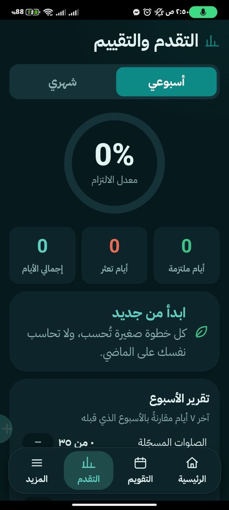

<div dir="rtl">

<p align="center">
  
</p>

<p align="center">
  <a href="https://github.com/alsaer-app/alsaer/actions/workflows/build.yml"></a>
  <a href="https://github.com/alsaer-app/alsaer/releases/latest"></a>
  
  
  
</p>

<p align="center"><b>تطبيق أندرويد إيماني شخصي، يعمل دون إنترنت بالكامل.</b><br>
كل بياناتك محفوظة على جهازك فقط، ولا تُرسل إلى أي خادم.</p>

---

## المزايا

### العبادة اليومية

- **المصحف الكامل**: صفحات المصحف (١٥ سطرًا) بخط عثماني، بروايتي حفص وورش، مع إبراز أحكام التجويد بالألوان؛ نص ٦٢٣٦ آية من مشروع تنزيل.
- **التلاوة والتسميع**: متابعة صوتية عبر محرك التعرف على الكلام في الهاتف، مع تصحيح فوري.
- **مواقيت الصلاة والتنبيهات**: إشعارات محلية مجدولة بنغمة مخصصة، تعمل بعد إعادة تشغيل الهاتف.
- **الأذكار والأدعية**: محتوى من الكتاب والسنة مع عدّادات.
- **جدول الصيام**: الاثنين والخميس، الأيام البيض، عاشوراء وعرفة، ستة شوال، صيام داود، وأيام مخصصة، مع تذكيرات السحور والإفطار.
- **التذكير العائم وودجت الشاشة الرئيسية**: تذكيرات تظهر فوق التطبيقات، ومتابعة يومية من الشاشة الرئيسية.

### المتابعة الذاتية

- **متابعة العادات والتوبة**: تسجيل أيام النجاح والانتكاسة مع الملاحظات والأسباب والمحفزات، وحساب دقيق لسلسلة الالتزام.
- **التقييم الذاتي**: مراجعة أسبوعية وشهرية ولوحة إنجازات.

### الخصوصية والحماية

- **قفل التطبيق**: برمز PIN أو كلمة مرور أو نمط، مع فتح بالبصمة وإيقاف مؤقت بعد المحاولات الخاطئة.
- **نسخ احتياطي مشفر**: تصدير واستعادة بكلمة مرور (AES-256-GCM مع PBKDF2-SHA256).
- **دون إنترنت**: لا حسابات، لا خوادم، لا تتبع.
- **واجهة عربية RTL** بثيمات فاتحة وداكنة، وتاريخ هجري (أم القرى) وميلادي.

## لقطات الشاشة

<p align="center">
  
  
  
  
  
  
</p>

## التثبيت

1. حمّل أحدث ملف APK من صفحة [Releases](https://github.com/alsaer-app/alsaer/releases/latest).
2. ثبّته على جهازك (قد يطلب أندرويد السماح بالتثبيت من مصادر خارجية).

**التحديث:** ثبّت النسخة الجديدة فوق القديمة مباشرة؛ بياناتك وإعداداتك تبقى كما هي طالما النسختان موقّعتان بالمفتاح الرسمي نفسه. ولفحص التحديثات، يقرأ التطبيق ملف [`update.json`](update.json) الذي يُحدَّث تلقائيًا مع كل إصدار جديد.

## البنية التقنية

- **Capacitor** (WebView) مع جسر Kotlin/Java أصلي (`com.ahmedalajmi.alsaer`).
- الواجهة صفحة واحدة بلا مكتبات خارجية: المصدر مقسّم في `src/` ويُجمَّع إلى `www/index.html` عبر `python3 tools/build_web.py`.
- بيانات المستخدم في `localStorage` تحت المفتاح `tawba_v1` (لا تغيّره أبدًا للحفاظ على بيانات المستخدمين).
- مكونات أصلية: إشعارات ومجدول تنبيهات، خدمة التذكير العائم، الودجت، البصمة، التعرف على الكلام.
- البناء والإصدار عبر GitHub Actions (انظر `.github/workflows/`).

## البناء من المصدر

```bash
npm install
python3 tools/build_web.py     # يجمع src/ في www/index.html
npx cap sync android
cd android && ./gradlew assembleDebug
```

لنسخة Release موقعة تحتاج ملف المفتاح وكلمات المرور عبر متغيرات البيئة؛ راجع [SETUP-SECRETS-AR.md](SETUP-SECRETS-AR.md).

## التحديث التلقائي

عند كل Tag جديد (`v*`) يبني workflow الإصدار الموقع ويرفعه إلى Releases ويحدّث ملف [`update.json`](update.json) على الفرع الرئيسي. يفحص التطبيق:

```
https://raw.githubusercontent.com/alsaer-app/alsaer/main/update.json
```

ويقارن `versionCode` بالنسخة المثبتة، ثم ينزّل `apkUrl` بعد التحقق من `sha256`.

## خارطة الطريق

- استكمال ترجمة كل الشاشات للغات إضافية.
- مزامنة سحابية اختيارية مشفرة (قيد الدراسة).
- تحسين محرك التلاوة المحلي.
- لوحة إنجازات وإحصاءات أعمق.

## الحقوق والمصادر

- نص المصحف: مشروع تنزيل (tanzil.net)، رواية حفص بالرسم العثماني، رخصة CC BY 3.0، منقول دون تعديل (يجب إبقاء هذه الإشارة).
- تخطيط صفحات المصحف: zonetecde/mushaf-layout (QPC1) وcpfair/quran-tajweed (CC BY 4.0) وfawazahmed0/quran-api (Unlicense).
- الخط: UthmanicHafs (مجمع الملك فهد لطباعة المصحف الشريف).
- حقوق الاسم والتصميم والكود لصاحب المشروع © 2026 AHMED ELAGAMY.

## التواصل

- فيسبوك: https://www.facebook.com/share/1E4Mr4L2Yd/
- واتساب: https://wa.me/201020372842

</div>

---

# Alsaer (السائر إلى الله) — English

A private, **offline-first** Android companion for worship and self-improvement. All data stays on the device; nothing is sent to any server.

**Features:** full mushaf reader (15-line pages, Uthmanic font, Hafs & Warsh riwayas, color-coded tajweed), recitation with speech recognition, prayer times and local reminders, a floating reminder overlay, a home-screen widget, habit and repentance tracking (streaks, relapses, triggers, urges), fasting schedule (Mondays/Thursdays, white days, Ashura, Arafah, Shawwal, Dawud, custom), adhkar with counters, weekly/monthly self-review, PIN/password/pattern lock with biometrics, encrypted password-protected backups (AES-256-GCM + PBKDF2), Arabic RTL UI with light/dark themes, Hijri (Umm al-Qura) and Gregorian dates.

**Install:** download the latest APK from [Releases](https://github.com/alsaer-app/alsaer/releases/latest) and install it over any previous officially-signed build; your data is preserved.

**Tech:** Capacitor (WebView) with a native Kotlin/Java bridge (`com.ahmedalajmi.alsaer`); single-page vanilla HTML/JS app split under `src/` and bundled by `python3 tools/build_web.py` into `www/index.html`; user data in `localStorage` (`tawba_v1`); native alarm scheduler, floating reminder service, widget, biometric and speech plugins; builds via GitHub Actions.

**Build:** `npm install && python3 tools/build_web.py && npx cap sync android && cd android && ./gradlew assembleDebug`

**Releases & auto-update:** pushing a `v*` tag builds a signed APK, publishes a GitHub Release, and refreshes `update.json` on `main` for in-app update checks. Signing uses GitHub Secrets only — see [SETUP-SECRETS-AR.md](SETUP-SECRETS-AR.md).

**Credits:** Quran text from tanzil.net (Hafs, Uthmani script, CC BY 3.0, unchanged — attribution required); page layout from zonetecde/mushaf-layout (QPC1), cpfair/quran-tajweed (CC BY 4.0), fawazahmed0/quran-api (Unlicense); UthmanicHafs font (King Fahd Glorious Quran Printing Complex). Name, design and code © 2026 AHMED ELAGAMY.
