<div dir="rtl">

<p align="center">
  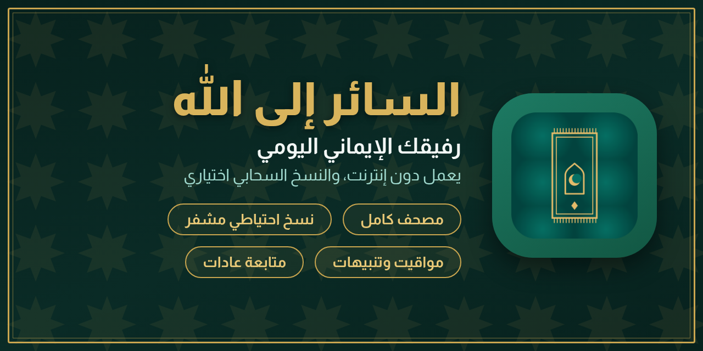
</p>

<p align="center">
  <a href="https://github.com/alsaer-app/alsaer/actions/workflows/build.yml"></a>
  <a href="https://github.com/alsaer-app/alsaer/releases/latest"></a>
  
  <a href="LICENSE"></a>
  
</p>

<p align="center"><b>رفيقك اليومي في الطريق إلى الله: المصحف، الصلاة، الأذكار، والمتابعة الذاتية، في تطبيق أندرويد عربي يحفظ بياناتك على جهازك.</b><br>
الأساس يعمل دون حساب ودون إنترنت. الراديو والقرّاء والفتاوى والأحاديث تحتاج إنترنت، ونسخ Google Drive اختياري. التفاصيل في <a href="PRIVACY.md">الخصوصية</a>.</p>

<p align="center">
  <a href="https://github.com/alsaer-app/alsaer/releases/latest"><b>⬇ تحميل أحدث نسخة (APK)</b></a>
  &nbsp;·&nbsp; <a href="#التثبيت">طريقة التثبيت</a>
  &nbsp;·&nbsp; <a href="#الخصوصية">الخصوصية</a>
  &nbsp;·&nbsp; <a href="#التواصل">التواصل</a>
</p>

---

## المزايا

### العبادة اليومية

- **المصحف الكامل**: صفحات المصحف (١٥ سطرًا) بخط عثماني، بروايتي حفص وورش، مع إبراز أحكام التجويد بالألوان؛ نص ٦٢٣٦ آية من مشروع تنزيل.
- **مواقيت الصلاة والتنبيهات**: إشعارات محلية مجدولة تعمل بعد إعادة تشغيل الهاتف، بنغمة خاصة لكل صلاة ونغمة موحدة للتذكيرات الأخرى. تُجمَّع التذكيرات في مجموعة واحدة مع ملخص هادئ، وفي كل تذكير أزرار «ابدأ» و«ذكّرني بعد ١٠ دقائق» و«إيقاف». ورد القرآن يُنبَّه في وقته بدقة.
- **تنبيه التحديث**: إشعار محلي واحد لكل إصدار جديد، يقرأ ملف `update.json` العام عبر https مرة يوميًا دون حساب ولا خدمات دفع، ولا يرسل شيئًا عنك.
- **الأذكار والأدعية**: محتوى من الكتاب والسنة مع عدّاد لكل ذكر؛ المعوذات (الإخلاص والفلق والناس) بندٌ لكل سورة، وتقدّمك المحفوظ ينتقل تلقائيًا دون فقد.
- **جدول الصيام**: الاثنين والخميس، الأيام البيض، عاشوراء وعرفة، ستة شوال، صيام داود، وأيام مخصصة، مع تذكيرات السحور والإفطار.
- **أسماء الله الحسنى**: ٩٩ اسمًا مع الدليل من الآيات، وحفظ ومسبحة واختبار، وشرح المعنى بالعربية.
- **حصن المسلم**: أذكار الصباح والمساء وبعد الصلاة وغيرها بعدّاد تكرار ومشاركة نص الذكر وتشغيل الصوت (الصوت يحتاج إنترنت).
- **راديو قرآن**: بث مباشر لإذاعات القرآن والبرامج الإسلامية (يحتاج إنترنت؛ قائمة المحطات في `www/radio-stations.js`).
- **استمع لقارئ**: سور المصحف الـ١١٤ بأصوات ١٥٨ قارئًا مع تصفية بالرواية والبحث وتشغيل متتابع (يحتاج إنترنت؛ القائمة في `www/reciters.js`).
- **فتاوى ابن باز رحمه الله**: ١٩٬٧٢٧ فتوى مكتوبة في ٢١٥ فئة مع بحث بالعنوان ونسخ ومشاركة ورابط المصدر، والاستماع للفتوى حيث يتوفر صوتها (بث مباشر أو تنزيل اختياري لكل ملف، ويحتاج إنترنت). تُحمَّل الشرائح عند الحاجة من مجلد `www/fatwas/` على الإنترنت وتُحفظ في ذاكرة التطبيق لتُقرأ بلا اتصال بعد أول فتح.
- **الأحاديث النبوية**: تسعة كتب مع البحث والمفضلة وحديث اليوم (يحتاج إنترنت).
- **أدوات الاستعداد**: ختمة القرآن، متابعة الحفظ بمراجعة متباعدة، المسبحة، قضاء ما فات، المناسبات الهجرية، وضع رمضان، حاسبة الزكاة، والأوقات المستحبة والمنهي عنها.
- **ست لغات إضافية للواجهة**: الإنجليزية والفرنسية والألمانية والتركية والفارسية والأردية إلى جانب العربية. النصوص الدينية (القرآن والأذكار والأدعية والأحاديث والفتاوى وأسماء الله) تبقى بالعربية. الترجمات راجعناها بأنفسنا وليست من مترجم متخصص.
- **التذكير العائم وودجت الشاشة الرئيسية**: تذكيرات تظهر فوق التطبيقات، ومتابعة يومية من الشاشة الرئيسية.

### المتابعة الذاتية

- **متابعة العادات والتوبة**: تسجيل أيام النجاح والانتكاسة مع الملاحظات والأسباب والمحفزات، وحساب دقيق لسلسلة الالتزام.
- **التقييم الذاتي**: مراجعة أسبوعية وشهرية ولوحة إنجازات.

### الخصوصية والحماية

- **قفل التطبيق**: برمز PIN أو كلمة مرور أو نمط، مع فتح بالبصمة وإيقاف مؤقت بعد المحاولات الخاطئة.
- **نسخ احتياطي بتشفير اختياري**: ملف مستقل أو نسخ مؤرخة إلى Google Drive بعد التفويض، مع AES-GCM وPBKDF2-SHA256 عند تفعيل كلمة المرور.
- **استخدام أساسي محلي**: لا يتطلب حسابًا لدى المطور. المحتوى والتحديثات تستخدم خدمات خارجية، وGoogle Drive يحتاج تفويضًا اختياريًا. انظر [مسودة سياسة الخصوصية](PRIVACY.md).
- **واجهة عربية RTL** بثيمات فاتحة وداكنة، وتاريخ هجري (أم القرى) وميلادي.

## لقطات الشاشة

<p align="center">
  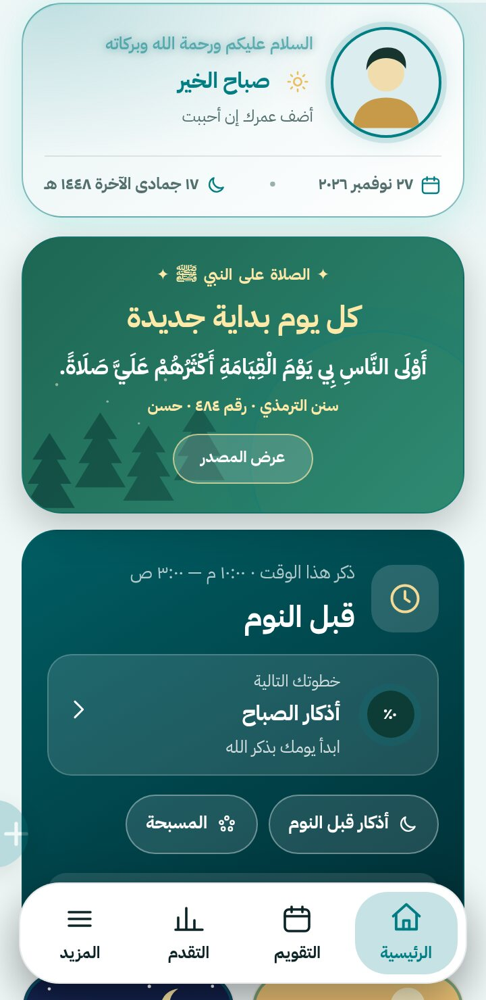
  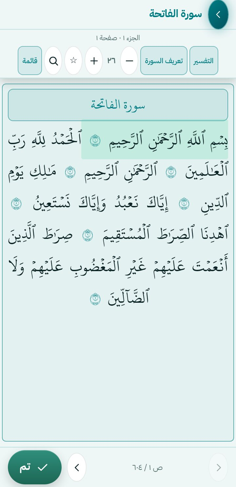
  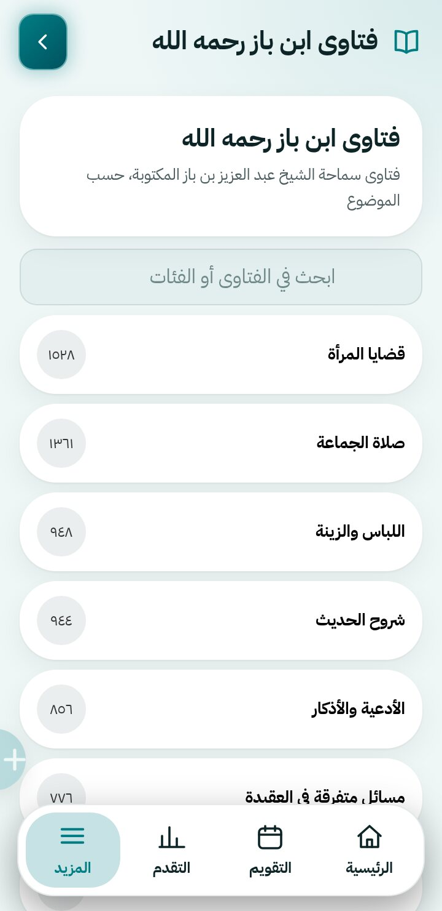
  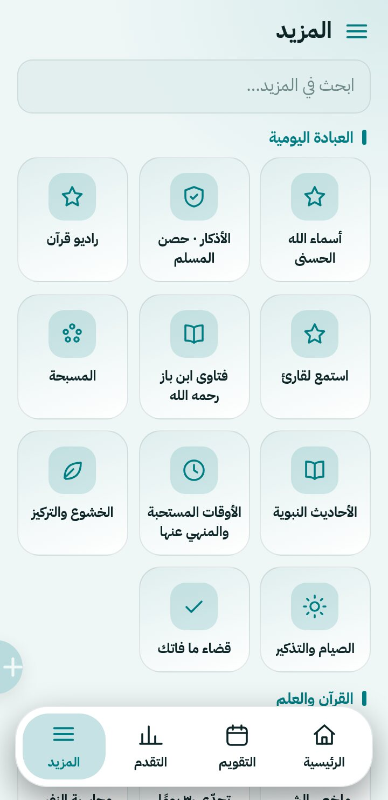
</p>
<p align="center">
  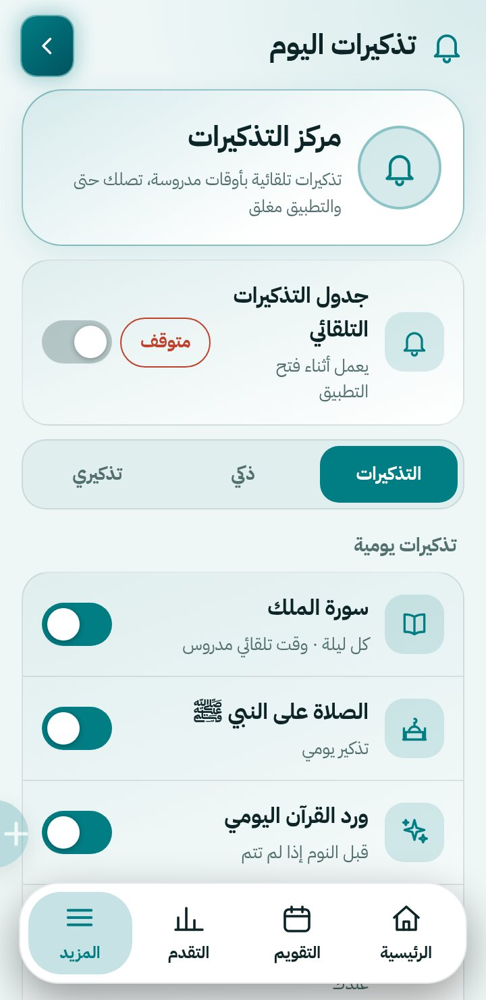
  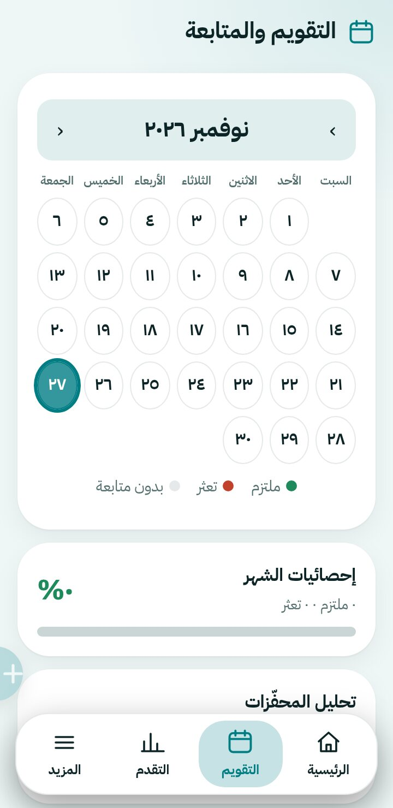
  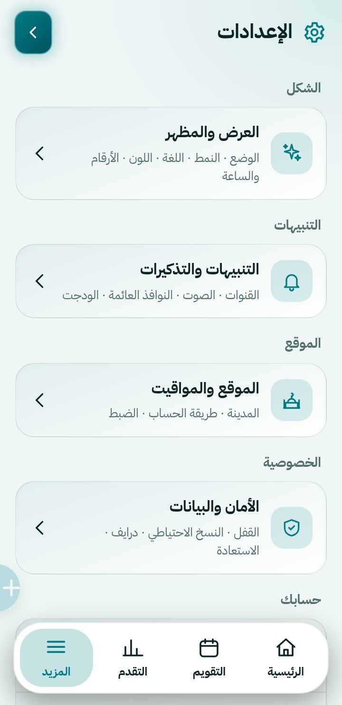
  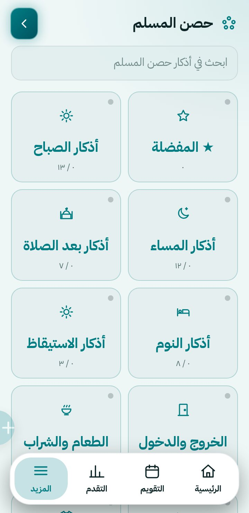
</p>

<details>
<summary>المظهر الداكن</summary>
<p align="center">
  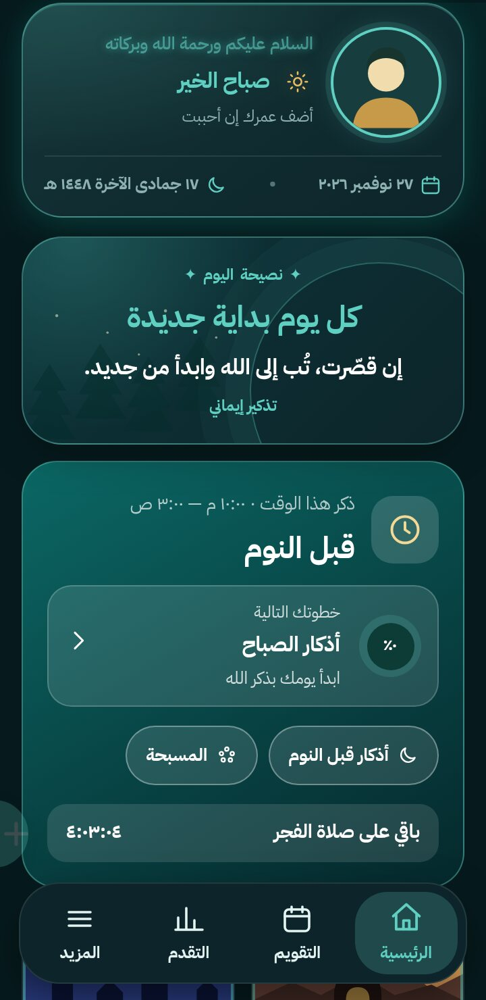
  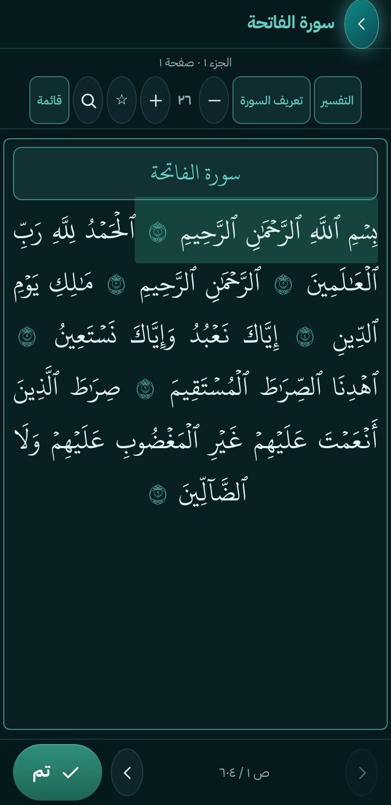
  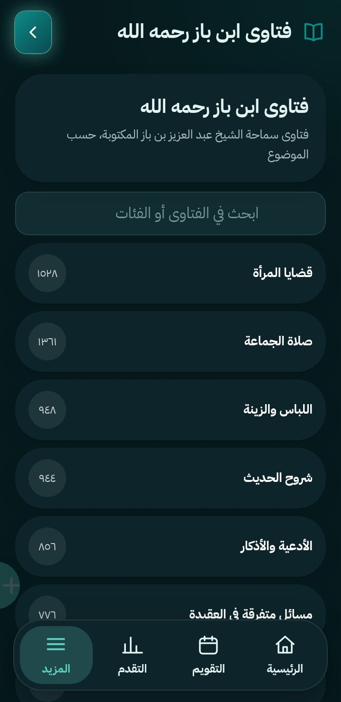
  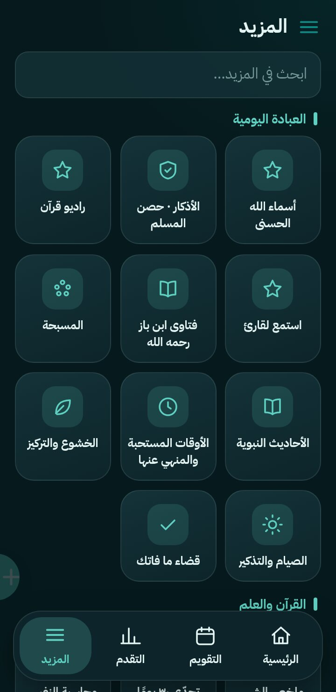
</p>
<p align="center">
  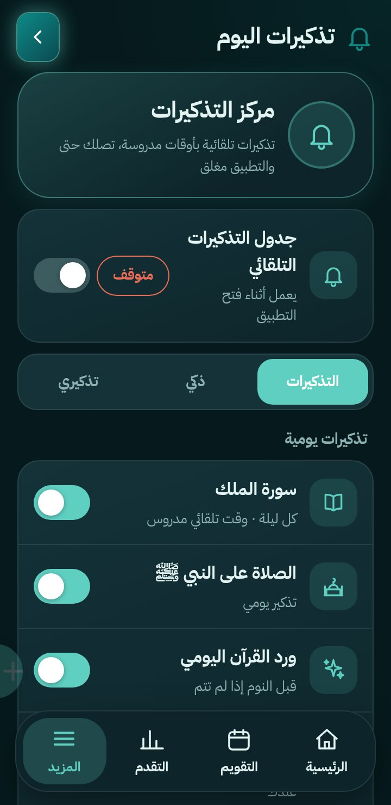
  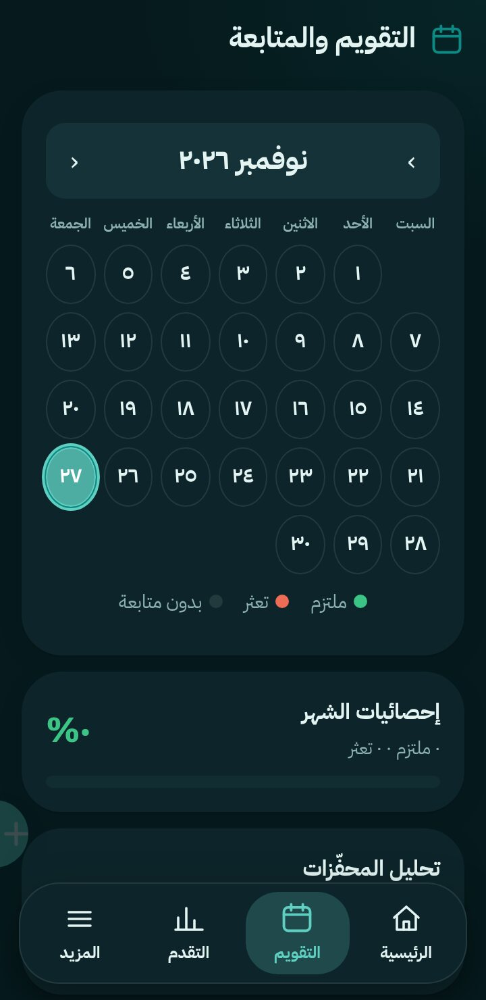
  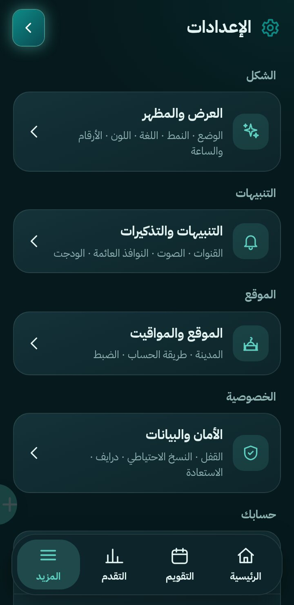
  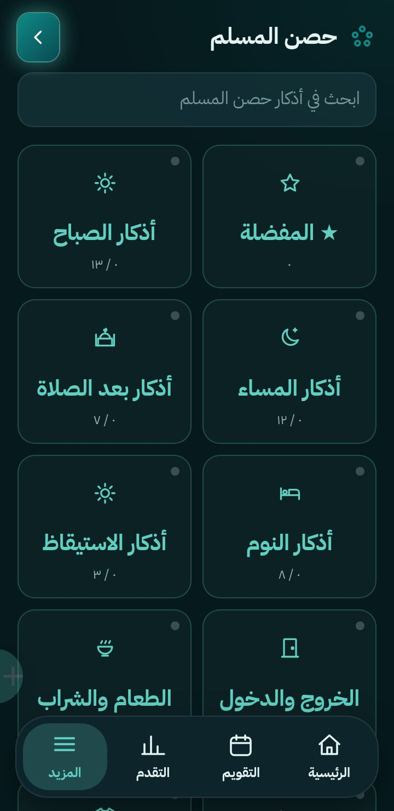
</p>
</details>

<p align="center"><sub>الصور مُولَّدة من واجهة الويب نفسها في متصفح بحجم هاتف (360×740، دقة مضاعفة) من آخر نسخة، وليست لقطات من جهاز أندرويد حقيقي، وبلا بيانات شخصية. نص المصحف يظهر كما في التطبيق دون أي تعديل.</sub></p>

## التثبيت

1. افتح صفحة [Releases](https://github.com/alsaer-app/alsaer/releases/latest) من هاتفك وحمّل ملف `.apk` من أحدث إصدار.
2. افتح الملف المحمّل. إن طلب أندرويد السماح بالتثبيت من هذا المصدر، فعّل الإذن لمتصفحك أو لتطبيق الملفات ثم ارجع.
3. اضغط «تثبيت». المتطلب: أندرويد 7.0 أو أحدث (minSdk 24).

**التحقق من الملف (اختياري):** الـAPK الرسمي موقّع بشهادة بصمتها SHA-256:
`647b477f5e19a79ec542b70d12476a166f3bf262ae7b5c2b1602bcc58a1c85e0`
فإن اختلفت بصمة الملف الذي حمّلته فلا تثبّته.

**التحديث:** ثبّت النسخة الجديدة فوق القديمة مباشرة؛ بياناتك وإعداداتك تبقى طالما النسختان موقّعتان بالشهادة نفسها. ويفحص التطبيق ملف [`update.json`](update.json) ويُنبّهك بإشعار محلي عند توفر إصدار أحدث.

**قبل أي تثبيت أو حذف:** خذ نسخة احتياطية من «الإعدادات ثم الأمان والبيانات» (ملف مستقل أو Google Drive).

## الخصوصية

- لا حساب لدى المطوّر، ولا إعلانات، ولا أدوات تحليلات. سجلاتك وملفك الشخصي وإعداداتك تبقى في تخزين التطبيق على جهازك.
- الموقع اختياري، ويُستخدم لحساب المواقيت والقبلة فقط.
- يتصل التطبيق بالإنترنت لجلب الراديو والقرّاء والفتاوى والأحاديث والتفسير، ولفحص ملف `update.json` مرة يوميًا. قد يرى مزوّد الخدمة عنوان IP كأي اتصال إنترنت.
- نسخ Google Drive اختياري بتفويض منك (صلاحية `drive.file`)، والتشفير بكلمة مرور اختياري (AES-GCM وPBKDF2-SHA256).
- النص الكامل في [PRIVACY.md](PRIVACY.md) وفي [docs/privacy.html](docs/privacy.html). هذه مسودة للمراجعة وليست إقرار Data Safety معتمدًا.

## البنية التقنية

- **Capacitor** (WebView) مع جسر Kotlin/Java أصلي (`com.ahmedalajmi.alsaer`).
- الواجهة صفحة واحدة بلا مكتبات خارجية: المصدر مقسّم في `src/` ويُجمَّع إلى `www/index.html` عبر `python3 tools/build_web.py`.
- بيانات المستخدم في `localStorage` تحت المفتاح `tawba_v1` (لا تغيّره أبدًا للحفاظ على بيانات المستخدمين).
- مكونات أصلية: إشعارات ومجدول تنبيهات، خدمة التذكير العائم، الودجت، البصمة.
- البناء والإصدار عبر GitHub Actions (انظر `.github/workflows/`).

## البناء من المصدر

```bash
npm install
python3 tools/build_web.py     # يجمع src/ في www/index.html
npx cap sync android
cd android && ./gradlew assembleDebug
```

لنسخة Release موقعة تحتاج ملف المفتاح وكلمات المرور عبر متغيرات البيئة؛ راجع [SETUP-SECRETS-AR.md](SETUP-SECRETS-AR.md).

## التحديث التلقائي

عند كل Tag جديد (`v*`) يبني workflow الإصدار الموقع ويرفعه إلى Releases ويحدّث ملف [`update.json`](update.json) على الفرع الرئيسي. يفحص التطبيق:

```
https://raw.githubusercontent.com/alsaer-app/alsaer/main/update.json
```

ويقارن `versionCode` بالنسخة المثبتة، ثم ينزّل `apkUrl` بعد التحقق من `sha256`.

## ما الجديد وما بعده

**في هذا الإصدار:**

- نسخ احتياطي مؤرخ إلى Google Drive الخاص بالمستخدم، مع تشفير اختياري على الجهاز.
- واجهة بسبع لغات (العربية وست إضافية، الترجمات مراجعة ذاتية).
- استماع للقرّاء والفتاوى، وراديو القرآن، وحصن المسلم الكامل.
- تنبيه محلي بالإصدار الجديد، وإشعارات مجمّعة بأزرار وتوقيت دقيق للورد.

**قيد العمل أو مخطط له:**

- مراجعة الترجمات بمراجع متخصص بدل المراجعة الذاتية.
- تجربة أوسع على أجهزة حقيقية (الإشعارات والموقع والتنبيه بالتحديث).
- ودجت محسّن: مواقيت الصلاة ومتابعة ورد اليوم.
- خطة ختمة ذكية بأهداف قابلة للتعديل التلقائي.
- لوحة إنجازات وإحصاءات أعمق.

## الحقوق والمصادر

- قائمتا القرّاء والفتاوى مأخوذتان من بيانات تطبيق التقوى (Altaqwaa): https://github.com/rn0x/altaqwaa-android. نصوص الفتاوى من الموقع الرسمي https://binbaz.org.sa (مؤسسة الشيخ عبد العزيز بن باز الخيرية)، وصوت القرّاء من https://mp3quran.net. نذكر المصدر فقط، والتفاصيل في docs/DATA_SOURCES.md.

- نص المصحف: مجمع الملك فهد لطباعة المصحف الشريف (KFGQPC)، رواية حفص، بيانات النسخة 18، منقول دون تعديل (عدا حذف رقم الآية). ملاحظة: النسخة مأخوذة من مرآة طرف ثالث (thetruetruth/quran-data-kfgqpc) وترخيص بيانات المجمع غير مؤكد رسميًا؛ يجب التحقق قبل النشر. خط المصحف: KFGQPC Hafs v2.2 (رخصته مضمنة في الملف). خط عرض ورش: Scheherazade New من SIL Global (رخصة SIL OFL 1.1، دون تعديل). التفاصيل في docs/DATA_SOURCES.md.
- تخطيط صفحات المصحف: zonetecde/mushaf-layout (QPC1) وcpfair/quran-tajweed (CC BY 4.0) وfawazahmed0/quran-api (Unlicense).
- الخط: UthmanicHafs (مجمع الملك فهد لطباعة المصحف الشريف).
- الكود متاح تحت رخصة [MIT](LICENSE) صدقةً عن صاحبه ووالديه؛ حقوق الاسم والشعار والهوية البصرية محفوظة لصاحب المشروع © 2026 AHMED ELAGAMY.

## التواصل

- للدعم والملاحظات والبلاغات: cvgj62240@gmail.com
- المشاكل والاقتراحات التقنية: [Issues](https://github.com/alsaer-app/alsaer/issues)
- فيسبوك: https://www.facebook.com/share/1E4Mr4L2Yd/

</div>

---

# Alsaer (السائر إلى الله) — English

An Arabic Android companion for daily worship and self-review. Your data stays on your device: no account, no ads, no analytics.

**What it does**
- Full Mushaf (Hafs and Warsh), prayer times with local reminders, Hisn al-Muslim and daily adhkar with counters, Names of Allah, fasting schedule, Khatma and memorisation review, zakat calculator, Hijri calendar.
- Quran radio, 158 reciters, 19,727 written fatwas of Ibn Baz, nine hadith books (internet needed for these).
- Habit and repentance tracking, weekly and monthly self-review.
- PIN, password or pattern lock with biometrics; backups to a file or your own Google Drive, with optional AES-GCM encryption.
- Light and dark themes. UI in Arabic, English, French, German, Turkish, Persian and Urdu. Religious texts stay Arabic; translations are self-reviewed, not professional.

**Install:** open [Releases](https://github.com/alsaer-app/alsaer/releases/latest) on your phone, download the `.apk`, allow installs from that source when Android asks, then install (Android 7.0+). Install new versions over the old one to keep your data. Official builds are signed with certificate SHA-256 `647b477f5e19a79ec542b70d12476a166f3bf262ae7b5c2b1602bcc58a1c85e0`. Back up before uninstalling.

**Privacy:** local-first. Network use is limited to content (radio, reciters, fatwas, hadith, tafsir), a daily check of `update.json`, and optional Google Drive backup that you authorise. Location is optional and used only for prayer times and qibla. Details in [PRIVACY.md](PRIVACY.md) (a draft for review).

**Support:** cvgj62240@gmail.com, or open an [issue](https://github.com/alsaer-app/alsaer/issues).

**Tech:** Capacitor (WebView) with a native Kotlin/Java bridge (`com.ahmedalajmi.alsaer`); single-page vanilla HTML/JS app split under `src/` and bundled by `python3 tools/build_web.py` into `www/index.html`; user data in `localStorage` (`tawba_v1`); native alarm scheduler, floating reminder service, widget, biometric plugins; builds via GitHub Actions.

**Build:** `npm install && python3 tools/build_web.py && npx cap sync android && cd android && ./gradlew assembleDebug`

**Releases & auto-update:** pushing a `v*` tag builds a signed APK, publishes a GitHub Release, and refreshes `update.json` on `main` for in-app update checks. Signing uses GitHub Secrets only — see [SETUP-SECRETS-AR.md](SETUP-SECRETS-AR.md).

**Credits:** Quran text from the King Fahd Glorious Quran Printing Complex (KFGQPC Hafs data v18, unmodified except the trailing verse number; obtained from the third-party mirror thetruetruth/quran-data-kfgqpc, data licence not officially verified); page layout from zonetecde/mushaf-layout (QPC1), cpfair/quran-tajweed (CC BY 4.0), fawazahmed0/quran-api (Unlicense); UthmanicHafs font (King Fahd Glorious Quran Printing Complex). Code is available under the [MIT License](LICENSE); the name, logo and visual identity remain © 2026 AHMED ELAGAMY. Warsh display font: Scheherazade New by SIL Global (SIL OFL 1.1, unmodified; see docs/licenses/scheherazade-new). See docs/DATA_SOURCES.md.
